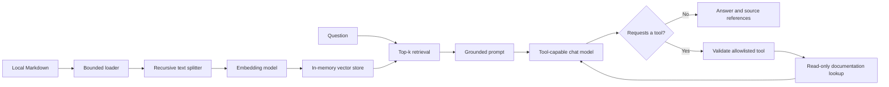

# DocQA Lab — LangChain RAG + Bounded Tool Calling

A **single-use-case** learning project: answer engineering onboarding questions over a **small, local Markdown documentation folder**, with visible source snippets and two read-only, validated tools. This is not an agent framework or a production knowledge-base service.

The project intentionally complements [TracePilot AI](https://github.com/kakarot987/tracepilot-ai), which focuses on incident investigation, runbook evidence, multi-role workflows and operational telemetry. DocQA Lab instead isolates *how retrieval and tool calling work* so each mechanism can be examined and tested independently.

## Features

- **LLM integration:** one configurable `ChatOpenAI` model using LangChain message abstractions; a pinned tool interface, low temperature, client retries, timeout and output limit.
- **RAG:** bounded `.md` ingestion, 800-character chunks with 120-character overlap, embeddings, `InMemoryVectorStore` cosine similarity, thresholded top-3 retrieval and `[S1]` evidence labels.
- **Tool calling:** `list_documents` and `read_document` only. The model can request them through `bind_tools`; execution uses allowlisted names and Pydantic validation. Two tool calls maximum per question.
- **Engineering:** deterministic offline retrieval fixture, mocked model/tool failure tests, GitHub Actions CI, token usage collection, optional configurable cost estimation and safe errors.
- **Delivery:** editable Python package, Dockerfile, Compose, Mermaid architecture, no secrets in Git, and a demo command.

**Important distinction:** `DOCQA_EMBEDDING=hash` is an offline *lexical hashing baseline* for reproducible demos; it does not understand synonyms and is **not** semantic search. Set `DOCQA_EMBEDDING=openai` (with a key) to try real semantic embeddings. The `demo` command does **not** call an LLM or claim to generate an answer. A live LLM call requires an API key.

## Quickstart

Requires Python 3.11+ and internet access to install dependencies.

```bash
git clone https://github.com/kakarot987/langchain-framework.git
cd langchain-framework
python -m venv .venv
source .venv/bin/activate               # Windows PowerShell: .venv\Scripts\Activate.ps1
python -m pip install -e ".[dev]"

# No API key needed:
docqa index
docqa demo
docqa evaluate
python -m pytest -q
ruff check .
```

Expected offline demo: the top retrieved file for the test question is `setup.md`; the tool lists `api.md`, `release.md` and `setup.md`. Evaluation prints a labeled hit-at-3 score. Those retrieval results validate *source selection only*, not answer correctness.

### Live model answers

```bash
# Set a real key in your shell (never commit it):
export OPENAI_API_KEY="..."
docqa ask "How do I run tests locally?"
docqa ask "Which documents can I read?"
```

For PowerShell: `$env:OPENAI_API_KEY = "..."`.

The first call embeds local docs using the configured embedding backend, retrieves matching chunks, invokes the chat model, and prints a grounded answer, retrieved filenames, tool events, token metadata and elapsed time. The model may choose **not** to call a tool on a given question; successful retrieval does not imply tool invocation. Change `DOCQA_MODEL` for another supported model. By default, only the chat generation requests require a paid API; local hash retrieval is free.

Use `DOCQA_DOCS=/path/to/markdown` or `docqa --docs /path/to/markdown ask "..."` to point at another local Markdown corpus. Every launch rebuilds the index in memory, so updates are picked up without a persistent database.

### Optional token-cost estimates

Set `DOCQA_INPUT_USD_PER_MILLION` and `DOCQA_OUTPUT_USD_PER_MILLION` to the provider's current **USD prices per million tokens** for the selected model. When usage counts are returned, the CLI prints an estimated charge. Prices are **not** hard-coded because they change; any actual billing may differ (e.g., cached tokens, tools, tiers).

### Docker / Compose

```bash
docker compose build
docker compose run --rm docqa                # offline demo
docker compose run --rm docqa evaluate
# With OPENAI_API_KEY in a local .env file:
docker compose run --rm docqa ask "How do I run tests locally?"
```

Compose uses an optional `.env` file (Compose v2.24+), read-only container filesystem, dropped Linux capabilities and no elevated privileges. The application does not open network ports; live LLM calls need outbound API access. `.env.example` documents configuration, but only a real local `.env` should contain credentials.

## Architecture



See [Architecture decisions](docs/ARCHITECTURE.md) for data boundaries, errors, trade-offs, and how this differs from TracePilot.

## Tests and evaluation

```bash
python -m pytest -q
ruff check .
docqa evaluate
docqa demo
```

Tests cover ingestion and symlink skipping, deterministic embeddings, retriever behavior, strict filename lookup, invalid/unknown tool requests, model failure, tool budgets, citation validation and a labeled hit-at-k fixture. All tests use a fake chat model—**no API key or paid inference needed**. The repository CI reruns them after every push/PR. A full *live* inference validation still needs user-supplied credentials and real provider access.

## Security and limitations

- Docs are local, trusted-as-files but treated as **untrusted instructions** to the chat model. Prompt injection remains possible; never ingest sensitive data or grant tool write permissions.
- File names accepted by `read_document` must match the index exactly. Files larger than 200 KB and corpora with more than 100 Markdown files are rejected; symlinked Markdown files are skipped.
- The app has no authentication, persistent storage, hosted service, or source-verification guarantee. Model citation text is checked against the retrieved source labels but **citation correctness and answer truth are not automatically verified**.
- Hash embeddings are deliberately basic, and the retrieval fixture is tiny. Hit-at-k is not answer accuracy. Model token usage depends on provider metadata; cost estimates require explicit pricing.
- Two calls is a tool **execution budget**, not a sandbox for model behavior. API timeouts and retries are best effort. Nothing executes shell commands or changes repositories.

## Suggested next steps

Capture a live provider screenshot or short terminal demo, add a larger held-out question set with answer/citation scoring, and compare semantic vs lexical recall and actual token spend. Expand scope only when the focused demo reveals a concrete need.
